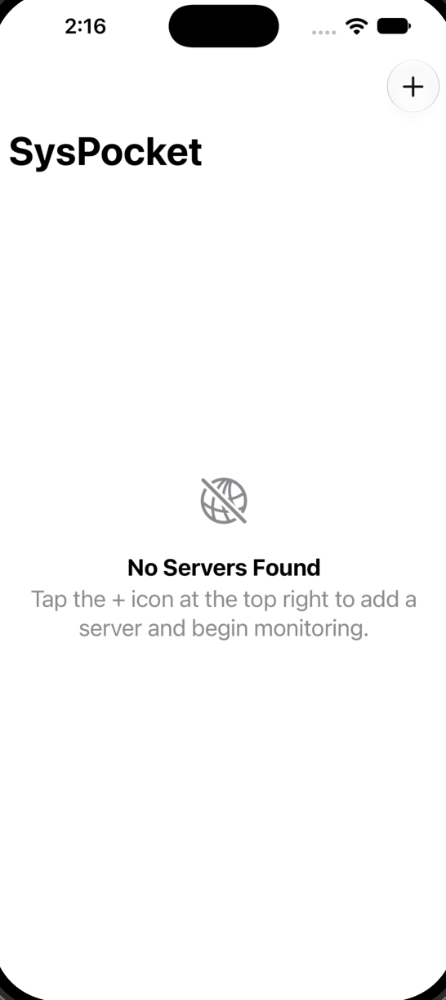
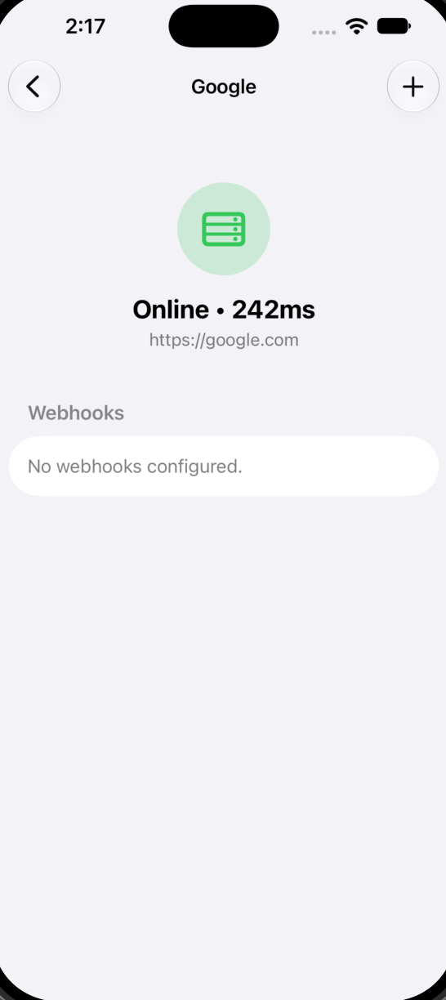
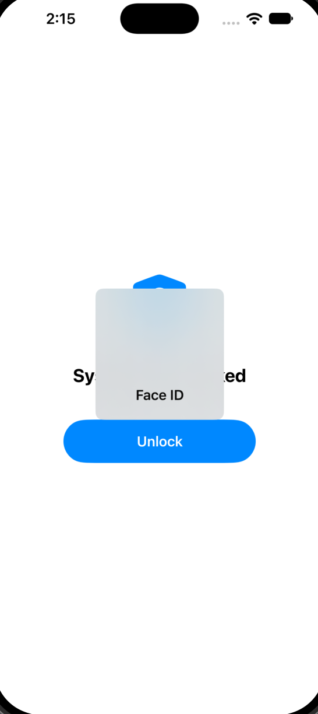
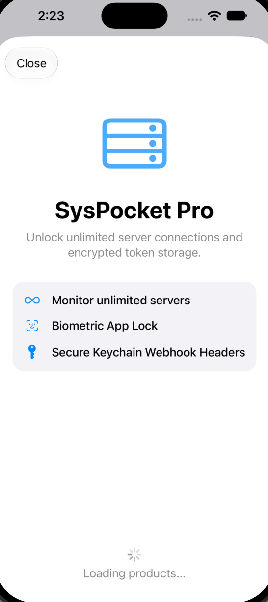

# SysPocket 🖧

SysPocket is a secure, native mobile control panel designed for solo developers and system administrators. It allows users to monitor server health via continuous background pinging, trigger custom webhooks with encrypted headers, and manage infrastructure directly from their iOS or iPadOS devices.

*^ Note: Replace this path with a landscape screenshot showing the iPad SplitView, or two iPhones side-by-side (Dashboard and Detail View).*

## 🚀 Features

* **Real-time Health Monitoring:** Utilizes asynchronous background streams to ping servers and calculate round-trip latency.
* **Encrypted Credential Storage:** Custom headers and API Bearer tokens are securely stored in the iOS Keychain and are completely isolated from standard `UserDefaults`.
* **Biometric App Lock:** Instantly locks the UI upon backgrounding, requiring Face ID or Touch ID to regain access to sensitive server configurations.
* **Interactive Webhooks:** Trigger remote scripts, deployments, or server restarts with visual execution feedback.
* **Universal Design:** Fully responsive UI utilizing `NavigationSplitView` to adapt seamlessly between iPhone navigation stacks and iPad sidebar layouts.
* **Native Monetization:** Integrates StoreKit 2 to handle a premium subscription tier, unlocking unlimited server configurations.

## 🛠 Architecture & Technical Stack

This project was built to demonstrate modern iOS engineering paradigms, strict concurrency, and clean separation of concerns.

* **UI Framework:** SwiftUI
* **Language:** Swift 6 (Strict Concurrency Checking enabled)
* **Local Persistence:** SwiftData (`@Model`, `@Query`)
* **Networking:** Native `URLSession` combined with `async/await` and `AsyncStream` for continuous data yielding. 
* **Security:** `LocalAuthentication` for biometrics and a custom `@MainActor` wrapper around Apple's C-based `Security` framework for thread-safe Keychain access.
* **In-App Purchases:** StoreKit 2, utilizing detached background tasks to listen for asynchronous transaction updates.

## 📸 Screenshots

| Dashboard | Server Health & Webhooks | Biometric Security | Pro Paywall |
|:---:|:---:|:---:|:---:|
|  |  |  |  |

*^ Note: Take screenshots in the simulator (Cmd + S). Create a folder named `docs` in your repository, place the images there, and update the filenames above to match.*

## 🧠 Core Engineering Highlights

### The Networking Engine
Instead of relying on delegate callbacks or Combine publishers, the networking layer is built on an isolated `actor`. This ensures thread-safe header injection across concurrent webhook triggers. Server monitoring utilizes a lightweight `HEAD` request wrapped in an `AsyncStream`, allowing the UI to react instantly to latency changes without memory leaks or heavy bandwidth usage.

### StoreKit 2 Integration
The `SubscriptionManager` operates asynchronously on the `@MainActor`. It listens to Apple's `Transaction.updates` sequence in a detached background task, ensuring the app reacts immediately to subscription renewals or revocations that occur outside the app's lifecycle, fully compliant with Swift 6 strict concurrency boundaries.

## 💻 Running Locally

To run this project locally, you will need Xcode 16+ and a device/simulator running iOS 18+.

1. Clone the repository.
2. Open `SysPocket.xcodeproj` in Xcode.
3. **StoreKit Testing:** To test the Pro subscription without a real App Store Connect account, select the `SysPocket` scheme at the top of Xcode, click **Edit Scheme > Run > Options**, and ensure the StoreKit Configuration is set to `Subscriptions.storekit`.
4. Build and Run (`Cmd + R`).
